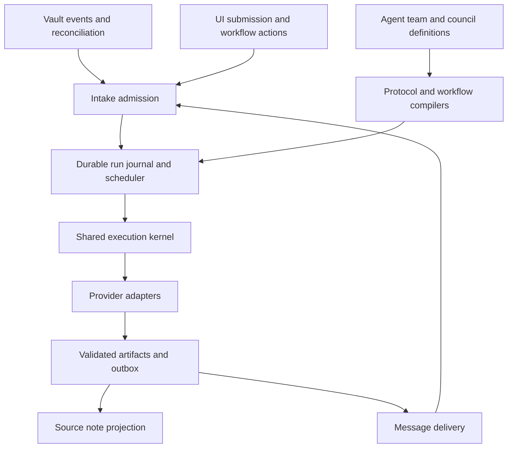

**Status:** Proposed PRD v1.0\
**Date:** 28 October 2026\
**Product owner:** Luis Mendez\
**Target:** [Luis85/coforge](https://github.com/Luis85/coforge)\
**Repository baseline:** main at [ddca02d6dbc8e53e9b82490a8577c84d6f3bbf4a](https://github.com/Luis85/coforge/commit/ddca02d6dbc8e53e9b82490a8577c84d6f3bbf4a)

The Council lets a CoForge user assemble reusable AI agents into teams and councils, submit Markdown notes through watched inboxes, and receive an attributable discussion and proposed implementation plans in the original note. Agents, councils, and existing workflows share intake, execution, messaging, recovery, and monitoring infrastructure.

The default council holds two sequential rounds. Every member first gives an independent opinion on the submitted note. After all required opinions have been saved, every member receives those opinions and proposes a solution. An optional chair can then consolidate the proposals. Configuration is maintained through CoForge’s UI and readable Markdown definitions.

Owner amendment, 28 October 2026: each round can choose **Round robin** (sequential members) or **Fan out** (concurrent members). The persisted `promptOrder` field is optional; absent fields keep legacy round-robin semantics and unchanged revisions. Round dependencies remain ordered, opinions remain independent and dependent rounds wait for committed, projected outcomes. This supersedes the original same-round sequential restriction when fan out is explicitly selected; it does not enable concurrent rounds or change existing captured runs.

Requirements below describe the proposed feature. Section 2 identifies the existing implementation and the changes needed to integrate it. Defaults are proposed product decisions, not previously approved owner decisions.

# 1 Product goals and release scope

## 1.1 Problem and intended outcome

A useful multi-agent review currently requires the operator to choose agents, copy the request between them, collect their answers, prepare a second prompt, and keep the discussion connected to the original work. Repeating this manually makes specialist roles difficult to reuse and loses the relationship between the request, reasoning, and resulting plan.

The Council should make that process repeatable: configure a council once, place a note in its inbox, and review its progress and results in CoForge or directly in Markdown. The same agent can answer a direct request, participate in several councils, and perform a workflow step without maintaining separate versions of its instructions.

The worker is deterministic application infrastructure. It detects eligible inputs, persists jobs, and dispatches configured work. It is not an additional AI decision maker.

## 1.2 Goals

- Maintain an agent pool as Markdown notes with a complete UI editor.

- Assemble persistent teams and reusable councils from that pool.

- Start agent tasks, council sessions, and workflows from configurable intake folders.

- Save each council contribution into the originating note, with durable attribution and progress.

- Support a shared team inbox and directed messages between permitted agents and councils.

- Reuse CoForge’s workflow, provider, review, and recovery capabilities.

- Make supported protocols extensible through configuration, with interfaces for new runtime capabilities.

- Keep execution understandable: who is running, why, with which input, and what can happen next.

## 1.3 First release

The first coherent release includes agent, team, and council definitions; complete UI management; the two-round council template and configurable sequential rounds; agent and council inboxes; workflow intake; shared informational messages; bounded directed requests and replies; a unified activity monitor; simulation; and interruption recovery.

The delivery phases in section 15 are implementation increments. Completion of an early phase alone does not satisfy the full feature.

## 1.4 Outside the first release

Continuous execution while Obsidian is closed, coordinated execution across multiple devices, parallel debate rounds, arbitrary executable code in notes, self-modifying agent permissions, and automatic code acceptance or deployment are outside this release.

An implementation plan is a generated result. Executing it requires a separately configured workflow action with CoForge’s existing access and review rules.

## 1.5 Success measures

These are proposed acceptance targets to validate during implementation:

| Measure | Target and measurement |
| - | - |
| Setup | A user familiar with CoForge creates three agents and an operational council through the UI without editing JSON or source code. Verify in a task-based usability session. |
| Default session | A three-member council produces six attributable contributions in the source note, in the configured order, without copying prompts manually. |
| Reuse | One agent definition works in a direct inbox task, two councils, and a workflow step; a saved edit affects their next runs. |
| Reliability | Duplicate-event, restart, write-failure, and unknown-provider-outcome acceptance scenarios pass without duplicate admitted submissions or lost committed contributions. |
| Explainability | Every invocation exposes its source snapshot, agent revision, provider/model, included artifacts, status, and actual usage where available. |
| Integration | Existing v1 workflows retain their execution, input-selection, import/export, and final-review behavior. |
| Performance | On a documented reference desktop with 10,000 vault notes and 500 notes in configured inboxes, incremental routing admits an eligible note within 5 seconds after its stability window when storage is healthy. Reconciliation is chunked and never requires an AI call. |

# 2 Existing CoForge foundation

The inspected baseline contains a working configurable workflow implementation. The Council should extend that foundation rather than introduce separate provider clients, competing queues, or a second UI-owned source of application state.

| Existing capability | Verified baseline | Required extension |
| - | - | - |
| Workflow definitions | Project-owned ordered AI, approval, and checklist steps; strict coforge-workflow/v1 schema; Markdown, screening, RICE, plan, and code-change outputs. [S1](https://github.com/Luis85/coforge/blob/ddca02d6dbc8e53e9b82490a8577c84d6f3bbf4a/docs/WORKFLOWS.md), [S3](https://github.com/Luis85/coforge/blob/ddca02d6dbc8e53e9b82490a8577c84d6f3bbf4a/src/plugin/features/coforge/domain/configured-workflow.ts) | Versioned agent references, council composition, and explicit artifact bindings. |
| Workflow inputs | configuredInputs selects the latest valid artifact of each output type. Multiple Markdown outputs do not remain a collection in the next prompt. [S4](https://github.com/Luis85/coforge/blob/ddca02d6dbc8e53e9b82490a8577c84d6f3bbf4a/src/plugin/features/coforge/application/configured-workflow-policy.ts) | Ordered named collections and explicit producer bindings for council rounds. |
| Execution and providers | ConfiguredWorkflowEngine uses StageRunner adapters for demo, native Claude, and managed Herdr execution. StageInput is currently coupled to an Idea. [S5](https://github.com/Luis85/coforge/blob/ddca02d6dbc8e53e9b82490a8577c84d6f3bbf4a/src/plugin/features/coforge/application/configured-workflow-engine.ts), [S6](https://github.com/Luis85/coforge/blob/ddca02d6dbc8e53e9b82490a8577c84d6f3bbf4a/src/plugin/features/coforge/application/ports.ts) | A shared invocation contract with a typed subject that can represent a note or an existing idea. |
| State and persistence | StudioStore serializes state mutations; VaultStudioStorage writes note files and plugin state separately. This is not a durable transaction across all files. [S7](https://github.com/Luis85/coforge/blob/ddca02d6dbc8e53e9b82490a8577c84d6f3bbf4a/src/plugin/features/coforge/application/studio-store.ts), [S8](https://github.com/Luis85/coforge/blob/ddca02d6dbc8e53e9b82490a8577c84d6f3bbf4a/src/plugin/infrastructure/coforge/vault-storage.ts) | A recoverable run journal and idempotent projections for note results and message delivery. |
| Recovery | Existing workflow definitions and artifacts are pinned. Reload requires recovery; Herdr cancellation can leave an external agent running. [S1](https://github.com/Luis85/coforge/blob/ddca02d6dbc8e53e9b82490a8577c84d6f3bbf4a/docs/WORKFLOWS.md) | Reuse uncertainty handling and paused restart behavior for council and agent work. |
| Architecture and UI | Framework-free domain/application code, application facades, injected host ports, Vue composables, and view-local Pinia state. [S2](https://github.com/Luis85/coforge/blob/ddca02d6dbc8e53e9b82490a8577c84d6f3bbf4a/docs/coforge/FOUNDATIONS.md), [S9](https://github.com/Luis85/coforge/blob/ddca02d6dbc8e53e9b82490a8577c84d6f3bbf4a/AGENTS.md) | New modules following the same dependency direction and public facade. |
| Host scope | The plugin manifest declares desktop-only support. [S10](https://github.com/Luis85/coforge/blob/ddca02d6dbc8e53e9b82490a8577c84d6f3bbf4a/manifest.json) | Desktop execution while the plugin is active; no implied background daemon. |

Two integration rules are essential. First, the current v1 workflow schema cannot faithfully represent a council simply by inserting many ordinary Markdown steps: its input selection loses earlier same-type answers. Second, a generic inbox note must not be disguised as a community Idea just to satisfy the current StageInput type.

# 3 Product model and vocabulary

| Concept | Meaning and ownership |
| - | - |
| Agent | A reusable definition of identity, role, instructions, provider/model preference, context policy, and requested capabilities. It is not a running provider session. |
| Agent pool | The vault-wide catalogue of agent definitions. Being in the catalogue grants no team context or project access. |
| Team | A persistent project-scoped roster with shared context, messaging policy, and a shared inbox. Setup creates one default team for the selected project. |
| Council | A team-owned deliberation definition with ordered participants, rounds, prompts, limits, and an optional intake. |
| Session | One council run against a captured input and configuration revision. |
| Inbox binding | A folder plus eligibility rules and a typed destination: agent, council, workflow, or team message space. |
| Message | A Markdown communication with an identity, purpose, sender, recipient, and thread. Some messages request work; others only provide information. |
| Run | Durable execution state, input/configuration snapshots, attempts, artifacts, and related child work. |
| Workflow | CoForge’s existing configurable process, extended to invoke reusable agents and councils and receive mapped inbox inputs. |
| Worker | The application service that observes intake candidates and schedules admitted work. |

An agent may belong to several teams and councils. Its instructions are shared; its private team context and provider conversation are not implicitly shared. Every invocation receives an explicit team and project scope. A direct agent inbox must therefore specify its context binding; an agent with several teams can expose several clearly named inbox bindings.

A council’s members must belong to its owning team. The UI may add an existing pool agent to the team and council in one explicit action. One agent cannot occupy two seats in the same council in v1; different personas use different agent IDs.

Stable IDs identify definitions and messages independently of filenames. Renaming or moving a note preserves its identity. Duplicating it creates a new ID. Historical runs retain display names and revisions even after definitions are archived.

# 4 Core user journeys

## 4.1 Create and maintain an agent

The user opens Agents, chooses Create agent, enters a name, role, instructions, and provider/model, then optionally adds context sources and an inbox. Saving creates a Markdown definition.

The detail view shows instructions, capabilities, inbox bindings, team and council memberships, validation status, and recent work. Open note exposes the same canonical definition. Editing the note updates the UI after validation; saving the UI preserves unrelated frontmatter and human text.

Duplicate creates a new identity. Archive disables new use and shows affected councils, workflows, and inboxes. Destructive deletion requires resolving dependent definitions; existing run evidence remains readable.

## 4.2 Assemble and test a council

The user selects a team, adds agents in order, chooses the standard Opinions and Solutions protocol, and selects an intake folder. The editor previews exactly what each round will receive and where results will be written.

Test with note supports a preflight preview and a deterministic simulation. Preflight resolves routing, participants, revisions, context, permissions, output placement, expected invocations, and limits without contacting a provider or sending messages.

After configuration is valid, the user enables the intake and resumes automation. Existing files are listed before activation; the default is to watch new arrivals.

## 4.3 Submit and follow a session

The user creates or moves a nonempty Markdown note into the council inbox. Once stable, it appears in the monitor. CoForge shows the current round and member and appends each completed contribution to the note.

If a member fails, saved contributions remain visible. The user can retry an eligible attempt, explicitly skip the contribution under the configured completion policy, or cancel. The final note contains all individual opinions and solution proposals, with optional synthesis and unresolved disagreements.

## 4.4 Exchange team messages

An agent can leave information for its team or request work from a permitted agent or council. The application validates and delivers the communication as a Markdown message.

The shared team inbox is a message board by default: information is available to members when they next run, subject to the configured context policy. It does not start a new run for every member. A deliberate broadcast action can instead create bounded per-recipient requests.

## 4.5 Connect a workflow

The existing Workflow settings view gains intake configuration and reusable agent/council choices. Before activation, the user sees the target project, subject mapping, selected workflow revision policy, output destination, and human checkpoints.

For example, a note can enter a proposal workflow, invoke the Design council, wait for a human to select a proposal, and then continue to a planning or implementation step. A council may also dispatch a separate workflow request when a configured policy allows it.

# 5 Functional requirements

Requirement IDs below are stable implementation and acceptance references. All requirements in this section belong to the first release unless a behavior is explicitly optional.

## 5.1 Definitions and agent management

**DEF-01 — Canonical Markdown.** Agent, team, and council definitions shall be Markdown notes with versioned typed frontmatter and readable bodies. The UI and direct Markdown editing shall operate on the same definitions. Workflow definitions remain project-owned as in the current product.

**DEF-02 — Identity and revisions.** Definitions shall have stable IDs. The application shall calculate a revision from normalized execution-relevant configuration and instructions. Renames alone shall not invalidate references. A run shall store the resolved revision and content it actually used.

**DEF-03 — Validation.** Saving or importing shall validate schema versions, references, duplicate IDs, paths, member order, input bindings, provider capabilities, and execution limits. Invalid externally edited definitions shall be visible and unavailable to new runs; the system shall not silently execute the last valid version as though it were current.

**DEF-04 — Editing and portability.** Users shall create, duplicate, rename, archive, import, and export supported definitions through the UI. Import shall preview a diff and reference-resolution plan before saving. Unknown fields in a reserved schema shall fail validation; unrelated frontmatter and namespaced extension data shall be preserved.

**DEF-05 — Agent behavior.** An agent definition shall contain instructions, role, provider/model selection, output defaults, allowed context sources, requested capabilities, and optional intake bindings. It shall reference connection profiles without storing credentials. The first release shall support the existing demo, native Claude, and managed Herdr execution paths where their advertised capabilities satisfy the task.

**DEF-06 — Authority and context isolation.** Effective capabilities shall be the intersection of agent requests, round/step restrictions, project policy, operator grants, and provider capability. Editing a prompt or imported note shall not grant tool access. Provider sessions shall be isolated by invocation/run scope so another team’s hidden conversation history cannot enter a council prompt.

## 5.2 Teams and councils

**COU-01 — Team ownership.** Each council shall belong to one team and selected project scope. The team shall define membership, shared inbox, context rules, and permitted messaging destinations.

**COU-02 — Default protocol.** A council shall offer two sequential rounds: independent opinions, followed by solution proposals from every configured member. Both rounds shall write each contribution to the originating note.

**COU-03 — Configurable rounds.** Users shall add, remove, rename, duplicate, and reorder supported ordered rounds; choose participants and publication order; choose per-round Round robin or Fan out prompt order; edit prompt templates; bind input collections; choose output contracts; and set completion rules. References may only target earlier rounds or captured input. A two-round template with round-robin members remains the default.

**COU-04 — Input isolation.** Within the default opinion round, every member shall receive the same captured source and shared context, plus its own instructions. Earlier opinions shall be excluded. Within the default solution round, every member shall receive the original source and the same ordered, persisted opinion collection. Earlier solution proposals shall be excluded.

**COU-05 — Persistence barriers.** In Round robin, a contribution shall be durably recorded and successfully projected before the next member is invoked. In Fan out, selected attempt intents and finite reservations shall be committed before concurrent dispatch; individual outcomes remain durable and are projected in participant order. A dependent round shall start only after the prior round’s configured completion rule and projection barrier are satisfied. An unknown outcome remains held for explicit recovery rather than replay.

**COU-06 — Optional synthesis.** Users may add a synthesis stage assigned to one member. It shall receive the selected opinion and solution collections, preserve disagreement, and produce a separately labeled recommendation. It shall not replace members’ second-round responses.

**COU-07 — Complete attribution.** Every result shall identify the session, round, participant, agent revision, attempt, provider/model, input artifact references, and timestamp. The UI shall distinguish a proposal, a synthesis, and a human decision. The system shall never infer unanimity from a synthesis.

**COU-08 — Failure policy.** Required contributions shall stop progression on failure by default. A configurable partial policy shall state a minimum successful participant count. Skipped or missing contributions shall be explicitly included in downstream context and final status. A zero-contribution round shall never satisfy a partial policy.

## 5.3 Watched inboxes and admission

**INB-01 — Shared intake.** Agent, council, and workflow bindings shall use the same intake service, eligibility evaluation, deduplication, durable admission, and monitoring. The watcher shall emit candidates; it shall not call providers.

**INB-02 — New submissions.** A newly created or moved-in nonempty Markdown note shall become eligible after a configurable stability window, initially 2 seconds. An explicitly marked draft shall remain pending; an optional Ready property or Submit action shall support deliberate submission. Empty notes shall remain pending until meaningful content arrives.

**INB-03 — Repeated events.** Admission shall be keyed by binding ID, stable source/message ID, and submission generation. Generated result writes, metadata updates, repeated events, renames, and ordinary edits shall not produce another submission. Run again shall create a new generation while retaining prior runs.

**INB-04 — Activation and reconciliation.** First activation shall preview existing eligible files and default to new arrivals only. The chosen baseline shall be recorded. Startup reconciliation shall discover unprocessed arrivals after that baseline, including files created while Obsidian was closed. AI execution shall remain paused after reload until resumed, matching CoForge’s current recovery posture.

**INB-05 — Routing and folders.** Each eligible source shall resolve to one intake binding unless an explicit fan-out operation creates separate deliveries. Overlapping watched scopes, loops through output folders, configuration directories, and private/public export overlap shall fail validation. Subfolder inclusion shall be explicit and off by default.

**INB-06 — Recoverable intake errors.** Duplicate source IDs, invalid YAML, unsupported files, oversized inputs, missing targets, and queue-capacity limits shall appear with actionable status. The original file shall remain intact. Deferred admission shall not mark a request processed; reconciliation shall revisit it after capacity is available.

**INB-07 — Ordinary notes.** A user shall be able to submit an ordinary Markdown note without constructing a message envelope. The host shall assign minimal namespaced identity and submission metadata before admission and exclude its own metadata changes from triggering.

## 5.4 Messages and collaboration

**MSG-01 — Explicit purpose.** Messages shall distinguish request, information, and reply. Only an eligible request shall create a new recipient run. Information and replies shall be stored and available as context without automatically starting another task.

**MSG-02 — Team visibility.** A shared team inbox shall make messages visible to its members in the UI. Prompt inclusion shall follow an explicit bounded policy. The default shall include pinned team notes plus up to 10 recent informational messages within the configured context allowance. Omitted items and the context snapshot shall be inspectable.

**MSG-03 — Directed delivery.** Agents shall be able to submit messages to allowed agents, councils, and team inboxes. Workflow dispatch shall use the same validated mechanism when enabled. Agents shall select logical recipient IDs; the host shall resolve paths and write the note.

**MSG-04 — Trusted provenance.** The host shall assign sender identity, originating run/step, recipient, thread, causation, timestamps, and root lineage. Model text and hand-edited frontmatter shall not manufacture trusted sender identity, completion state, or permission.

**MSG-05 — Durable delivery.** Validated outgoing messages shall be recorded in an outbox with the result that created them. Delivery shall be replayable by stable message/destination ID without generating another model response or duplicate recipient admission. A delivery problem shall have a separate status from a successfully produced contribution.

**MSG-06 — Bounded delegation.** Agent-generated requests shall obey allowed-recipient rules, causal depth, descendant-run, message, invocation, and execution-time limits inherited from the root request. Creating another message or council shall not reset these limits. Requests to an active ancestor shall be blocked in v1; an informational reply remains possible.

**MSG-07 — Thread control.** The operator shall inspect the request/reply tree and stop future dispatch for the entire root conversation. Completion replies shall link the resulting note or artifact and shall not automatically invoke the sender. Automatic replanning from replies requires an explicit bounded workflow in a later version.

## 5.5 Workflow integration

**WF-01 — Intake mapping.** Each project workflow may configure an intake folder and map note content to named workflow inputs. The UI shall preview the project, subject mode, output destination, and validation conditions.

**WF-02 — Subject modes.** The integration shall support a generic note subject for compatible analytical steps and an explicit link to an existing CoForge Idea. Creating a new Idea shall require an explicit mapping policy with operator provenance and private visibility. Generic messages shall not fabricate viewer authorship, votes, rewards, or approval.

**WF-03 — Reusable execution.** A workflow AI step shall be able to reference an agent definition. A council step shall invoke the same pinned council protocol used by a direct inbox session and return a structured council result. Workflow message steps shall publish information or dispatch permitted requests.

**WF-04 — Explicit artifacts.** New definitions shall bind inputs by producer, artifact ID, or named ordered collection. Opinion and solution collections shall retain every member’s result. Existing v1 latest-per-output selection shall remain unchanged.

**WF-05 — Composed results.** A council result shall expose opinions, solution proposals, missing contributions, dissent, optional synthesis, and source links as typed data with Markdown representations. Passing a result into an existing plan or code-change contract shall require a validated mapping or transformation step. Arbitrary prose shall not be relabeled as a validated implementation plan.

**WF-06 — Shared gates.** Council composition, inbox intake, and agent messages shall preserve project implementation permissions, worktree isolation, workflow checkpoints, moderation/vote rules when an Idea is the subject, and final host review of actual code changes.

**WF-07 — Version compatibility.** V1 definitions and captured runs shall remain readable and executable with their original semantics. Saving a definition that uses new features shall create an explicit versioned v2 definition. Opening a legacy project shall not migrate it or start work.

## 5.6 Operations and observation

**OPS-01 — One monitor.** The automation monitor shall show agent tasks, council sessions, workflows, and message deliveries with filters by project, team, target, source, and state.

**OPS-02 — Meaningful controls.** Users shall pause global or project execution, pause a run at an action boundary, cancel queued work, request cancellation of active work, retry eligible failures, and repair note publication separately. A reason shall explain every blocked or paused state.

**OPS-03 — Preflight and simulation.** Preflight shall make no provider calls or agent-message deliveries. Simulation shall use deterministic fake results, visibly mark all artifacts simulated, and write only to an explicit test destination. A successful simulation shall not be represented as live-provider qualification.

**OPS-04 — Usage and diagnostics.** Costs and tokens shall come from provider/host telemetry where available. Missing usage shall display as unknown. Technical logs shall exclude note bodies, prompts, credentials, and sensitive paths; private run views may expose the content required for inspection.

**OPS-05 — Host lifecycle.** The runtime shall start after the vault is ready and dispose all subscriptions, timers, and dispatch capability on unload. Accepted work shall remain recoverable. V1 shall have one designated execution device per vault and one active provider invocation globally by default.

# 6 Session execution contract

## 6.1 Default sequence

For a council with N members, the default contains 2N model invocations before retries or provider tool turns. A chair synthesis adds one invocation. The UI shall distinguish an invocation from the model’s internal/tool turns.

1. Admit the submission and create a run with a frozen source, team context, definitions, participant order, and effective permissions.

2. Invoke the first member’s opinion step with the source snapshot and that member’s instructions.

3. Validate and persist the returned contribution, then append its managed section to the source note.

4. Repeat for every remaining member, using the same shared first-round input.

5. Seal the ordered opinion collection and record the round barrier.

6. Invoke each member’s solution step with the source snapshot and the complete sealed opinion collection.

7. Persist and project each solution before advancing.

8. If configured, invoke the chair with the selected collections and save its synthesis.

9. Finalize the session status and expose the structured council result.

The default council rounds shall receive host-supplied context with project and vault read tools disabled. Supplying an isolated prompt alone is insufficient if an agent can read the live transcript through project tools. A protocol that enables read tools shall require an adapter-enforced restricted or snapshot view excluding the live transcript, sibling outputs, private journal, and other teams’ material. If an adapter cannot enforce the declared isolation, preflight shall fail. This preserves independence in round one even though answers are already visible in Markdown.

New team messages arriving during a session shall be available to subsequent runs. Including live messages mid-session would change the shared input; that behavior is outside the default protocol.

## 6.2 Snapshot and authority rules

Capture the source body outside generated sections; applicable project/team context; selected team messages; agent/council revisions; prompt templates; provider/model choices; bindings; limits; and effective grants when the run is admitted.

Configuration changes affect future runs. A disabled target, revoked capability, global/project pause, or unavailable credential shall still block subsequent actions in an existing run. A snapshot shall never preserve permission that the operator has revoked.

A queued run remains tied to its captured revision. If the user changes the request, the UI shall offer cancellation and a new submission rather than silently changing queued work.

## 6.3 States and action boundaries

| State | Meaning and next action |
| - | - |
| Queued | Accepted and durable; waiting for execution eligibility. |
| Running | One invocation, one permitted fan-out batch, or a local execution action is active. |
| Publishing | A contribution is durable; its source-note projection is incomplete. Retry publication without another model call. |
| Waiting for human | A workflow checkpoint or recovery decision requires input; the provider slot is released. |
| Paused | A user or policy has stopped future dispatch. Resume rechecks current grants and dependencies. |
| Attention | A conflict, invalid dependency, failed required contribution, or uncertain external outcome requires a specific recovery action. |
| Completed | All required work and result projections succeeded. Message delivery status remains separately visible. |
| Completed with gaps | The declared partial policy was satisfied with explicitly recorded missing contributions. |
| Cancelled | No further actions are admitted. An external attempt may still require settlement. |
| Failed | The run cannot progress under its current policy; preserved evidence remains available. |

Pause stops before the next external action; it does not claim to interrupt a provider instantaneously. Cancel requests provider cancellation where supported and stops descendants from launching. A Herdr operation may continue externally after the local wait ends, consistent with existing CoForge behavior. [S1](https://github.com/Luis85/coforge/blob/ddca02d6dbc8e53e9b82490a8577c84d6f3bbf4a/docs/WORKFLOWS.md)

A parent workflow waiting for a council result shall not occupy the provider slot. The scheduler shall schedule executable member work and allow unrelated ready runs to progress. Council round dependencies remain ordered; members follow the captured Round robin or Fan out setting inside each round.

## 6.4 Durable result and publication sequence

The runtime shall journal an admitted attempt before dispatch. When a validated response returns, it shall durably commit the result, its attribution, and any validated outgoing message intents before considering the response received.

The note projector shall then apply a uniquely identified contribution block. Only after that write succeeds shall the execution cursor pass the publication barrier. An outbox dispatcher shall separately make committed messages visible to recipients.

If the process stops after result persistence but before note publication, reconciliation shall publish the saved result. If the process stops after note publication but before acknowledging the projection, reconciliation shall recognize the existing block and avoid appending it twice.

If the provider may have accepted a call but no outcome was durably recorded, mark the attempt outcome unknown. Do not silently replay it. The operator shall inspect the original external session where available and decide whether to retry. The product promises deduplicated admission and idempotent local publication, not universal exactly-once model execution.

## 6.5 Changes to the source note

The projector shall preserve human text and unrelated frontmatter. It shall follow source identity through moves and renames.

If the human input changes during execution, retain the original run snapshot, mark it stale relative to the current note, and pause before the next invocation. The user may continue using the original snapshot or cancel and submit a new generation. Results remain labeled with the source revision they address.

If a user edits a generated block, retain both their edited text and the recorded artifact and raise a projection conflict. Recovery shall never silently replace the edit. If the source note is deleted, retain the run and results; offer export or explicit reassignment to another note without recreating the deleted file.

A source-note display of Completed shall not confer runtime authority. Journal records and existing integrity protections remain authoritative for execution and review.

# 7 Data model and Markdown contracts

## 7.1 Canonical ownership

| Data | Canonical representation |
| - | - |
| Agent instructions and configuration | Agent Markdown definition. |
| Team membership and communication/context policy | Team Markdown definition. |
| Council members, rounds, prompts, and bindings | Council Markdown definition. |
| Project workflow | Existing project note, with explicit versioning for new constructs. |
| Inbox binding | Typed configuration owned by its target definition or project; indexed through the common intake catalogue. |
| Submitted request and human annotations | Source Markdown note. |
| Message body | Message Markdown note, with host-verified delivery/provenance records. |
| New agent, council, and v2 run snapshots, attempts, authoritative artifacts, deduplication, outbox, permissions | Private durable execution journal. |
| Transcript and visible run status in notes | Idempotent projections of journal evidence. |

Definitions and notes shall be readable without CoForge. The private journal is necessary for runtime trust and recovery; visible Markdown alone shall not authorize replay or prove that a provider action completed.

Legacy v1 runs and histories shall retain their current canonical note representation and integrity anchors through the compatibility adapter. They shall not acquire a second canonical copy in the new journal. The adapter may expose one common read model; transferring ownership requires an explicit verified migration. New v2 projections shall be schema-distinct so they cannot be parsed or trusted as legacy v1 progress.

Journal design shall support versioning, damaged-record detection, temporary-write recovery, and bounded retention. Never prune active/uncertain runs, pending projections, outbox entries, or submission tombstones needed to prevent replay. Removing old readable histories shall not make old inbox notes eligible again. The UI shall offer export and a scoped reset whose replay consequences are explicit.

## 7.2 Suggested vault organization

All folders are configurable. A suggested initial structure is:

| Folder | Contents |
| - | - |
| CoForge/Agents | Reusable agent notes. |
| CoForge/Teams | Team definitions. |
| CoForge/Councils | Council definitions. |
| CoForge/Inboxes/Agents | Agent-specific intake folders. |
| CoForge/Inboxes/Councils | Council-specific intake folders. |
| CoForge/Inboxes/Workflows | Project workflow intake folders. |
| CoForge/Messages/Teams | Shared team messages. |
| CoForge/Sessions | Optional readable run summaries and exports. |

Every configured definition, intake, message, and private export folder shall be registered with the folder policy, public-board exclusions, and applicable private-data guard before initial writes or activation. The current guard does not automatically cover arbitrary new custom folders outside its existing protected paths; those protections must be extended. Existing tracked Git files are not removed by adding ignore rules. [S16](https://github.com/Luis85/coforge/blob/ddca02d6dbc8e53e9b82490a8577c84d6f3bbf4a/src/plugin/features/coforge/domain/vault-folder-policy.ts), [S17](https://github.com/Luis85/coforge/blob/ddca02d6dbc8e53e9b82490a8577c84d6f3bbf4a/src/plugin/infrastructure/coforge/private-data-guard.ts) Portable definition exports shall omit credentials, runtime provenance, and private execution state. Importing a definition shall require resolving local connection profiles and grants before enabling execution.

## 7.3 Illustrative agent note

The schemas below are proposed contracts for implementation, not formats currently accepted by CoForge. Bodies use one managed Instructions section; additional user sections remain intact. The UI may expose nested configuration more conveniently than Obsidian’s generic Properties view.

```yaml
---
coforge:
  schema: agent/v1
  id: agent-architect
  name: Software Architect
  enabled: true
  provider: claude
  model: sonnet
  connection_profile: local-claude
  requested_capabilities:
    project: read
    messaging: propose
  context:
    sources:
      - "[[Project Architecture]]"
  inboxes:
    - id: inbox-architect
      path: CoForge/Inboxes/Agents/Architect
      team_id: team-studio
      project_id: CFP-001
      enabled: false
      recursive: false
      submit: after-stable
      settle_ms: 2000
---
```

The Markdown body contains an Instructions heading followed by the agent’s editable role guidance, for example: “Assess module boundaries, responsibilities, interfaces, and implementation risks. State assumptions and explain tradeoffs.”

Requested capabilities are bounded by grants held outside the editable note. This example does not grant access merely by listing it.

## 7.4 Illustrative council note

```yaml
---
coforge:
  schema: council/v1
  id: council-feature-design
  name: Feature Design Council
  enabled: true
  team_id: team-studio
  project_id: CFP-001
  members:
    - agent-product
    - agent-architect
    - agent-qa
  rounds:
    - id: opinions
      name: Opinions
      mode: each-member
      execution: sequential
      inputs: [source, team-context]
      access: none
      instructions_section: Opinion instructions
      output: markdown
      collect_as: opinions
      completion: all
    - id: solutions
      name: Solutions
      mode: each-member
      execution: sequential
      inputs: [source, team-context, opinions]
      access: none
      instructions_section: Solution instructions
      output: markdown
      collect_as: solutions
      completion: all
  inbox:
    id: inbox-feature-design
    path: CoForge/Inboxes/Councils/Feature Design
    enabled: false
    recursive: false
    submit: after-stable
    settle_ms: 2000
  result:
    destination: source-note
    append_contributions: true
    synthesis: none
  limits:
    max_invocations: 24
    max_generated_messages: 10
    max_descendant_runs: 10
    max_delegation_depth: 3
    max_execution_seconds: 900
---
```

The council body contains the editable Opinion instructions and Solution instructions sections. Stable round IDs drive bindings; display names and heading text do not select provider tools.

Reordering a round shall trigger validation of its upstream dependencies. A round may deliberately include prior results, but the preview shall show that choice. Future protocols can compose registered primitives without embedding JavaScript or executable expressions.

## 7.5 Message envelope

A host-created message shall contain, at minimum:

| Field | Purpose |
| - | - |
| Schema and message ID | Parse safely and detect duplicate identity. |
| Purpose | request, information, or reply. |
| Sender and recipient | Logical identities and type; host-authenticated provenance. |
| Project and team scope | Context and permission boundary. |
| Root request, thread, causation, reply-to | Trace delegation and replies. |
| Originating run and action | Attribute generated communications. |
| Created time and optional expiry | Ordering and stale-request policy. |
| Submission generation | Deliberate resubmission identity. |
| Body and artifact links | Human-readable content and referenced results. |

Delivery, claiming, and completion state belong to the journal and are projected for inspection. Hand-edited values cannot turn a message into a trusted agent request. A manually authored message may be admitted as operator-originated input under the configured intake policy.

## 7.6 Result layout in the source note

The original content remains at the top. Each session adds a labeled section containing its state, input revision, timestamps, and contributions:

- Opinions: one attributed subsection per member, in configured order.

- Solutions: one attributed subsection per member, in configured order.

- Optional synthesis: recommendation, alternatives, disagreements, and open questions.

- Outcome: completion status, gaps, related messages, and next actions.

Stable internal markers identify each projected contribution independently of its visible heading. Identifiers include run, round, member, and selected artifact; attempt history remains available in the monitor. Model output is escaped or encapsulated so it cannot inject ownership markers or impersonate host-generated status.

A new submission adds a new session section. It shall not overwrite the previous discussion.

# 8 Context, messaging, and resource policy

A council needs finite, explicit context. The resolver shall include the selected source snapshot, required linked material, pinned project/team context, and chosen result collections. Arbitrary vault traversal and recursive link expansion are disabled by default.

Required opinions shall not be silently truncated to fit a model. The preflight shall estimate prompt size and reserve output capacity; an invocation that cannot fit shall pause before dispatch and explain the offending sources. Optional context may be omitted according to a visible priority policy. A future explicit summarization step may compress a collection while retaining links to its originals.

Agent-generated messages shall be structured delivery proposals, never instructions to write an arbitrary vault path. The host shall validate destinations, scope, size, expiry, capability, and remaining root limits before committing them.

| Proposed default | Behavior |
| - | - |
| Global provider concurrency | 1 invocation, shared with existing workflow execution. |
| Stability window | 2 seconds after the last relevant source change. |
| New council rounds | Opinions then Solutions, sequential, all contributions required. |
| Shared context | Pinned team context plus at most 10 recent informational messages within the context allowance. |
| Agent-generated requests | Disabled until the operator grants an explicit recipient policy. Informational proposals remain subject to that policy. |
| Root invocation allowance | 24 dispatches, counting retries and descendant work. |
| Outgoing generated messages | 10 across the root conversation. |
| Descendant runs | 10 across the root conversation. |
| Delegation depth | 3; a new actionable request to an active ancestor is blocked. |
| Root execution allowance | 15 minutes accumulated across dispatched automatic actions, including provider waits. Queue time, human checkpoints, user pauses, and time with the plugin unloaded do not count. Exhaustion stops new dispatch until an explicit extension. |
| Retry | At most 2 automatic retries for positively classified failures where the provider did not accept execution. Otherwise require recovery. |
| Restart | Reconcile local state and pending projections; keep provider execution paused. |

Before the first provider call, preflight every root or child council against its minimum required invocation count, including configured synthesis and statically required child work. If that minimum exceeds the remaining root allowance, block execution and require adjusted configuration. Reserve required remaining actions and result-storage capacity before optional delegation can consume the surplus. A root council with 13 members therefore needs at least 26 invocations and cannot start under the proposed default allowance of 24.

These root allowances apply to new council and v2 workflow execution; existing v1 workflow limits retain their semantics. A council invoked by a v2 workflow receives the stricter of its own limits and the parent’s remaining allowance. An optional message expiry is a separate wall-clock deadline. An interrupted action with an uncertain outcome remains held for recovery regardless of how much execution allowance remains.

Timeouts and cost allowances must reflect adapter capabilities. CoForge can always stop admitting new work; it cannot claim to stop an externally running Herdr process or enforce a hard provider spending cap where the adapter cannot do so. Show enforced limits separately from estimates and advisory limits. [S1](https://github.com/Luis85/coforge/blob/ddca02d6dbc8e53e9b82490a8577c84d6f3bbf4a/docs/WORKFLOWS.md)

A reply completes a communication thread without waking its sender. In v1, receiving a reply does not automatically resume an agent, council, or workflow. The user may review replies before manually continuing a supported human checkpoint. Reply-triggered workflow transitions and autonomous replanning are deferred.

# 9 Composable architecture

## 9.1 Recommended structure

A pure CouncilProtocolCompiler shall translate a validated council snapshot into a bounded immutable execution plan. The same compiler shall serve a council inbox and a council step inside a workflow.

A shared execution kernel shall own scheduling, action claims, provider invocation, attempt settlement, budgets, artifact validation, and recovery. Council application services shall own definition management, compilation, and result assembly. They shall not own a competing provider loop.

Existing v1 workflows shall enter this kernel through a compatibility adapter. New workflow definitions may use agent references, explicit collections, and a council composite. The legacy Idea adapter shall preserve screening, status, votes, worktrees, review, and community/publication behavior.



The diagram shows runtime responsibilities, not direct import permission. Domain policies and plan types shall remain independent of Obsidian, Vue, Pinia, Node APIs, and concrete provider implementations.

## 9.2 Interfaces and responsibilities

Names are proposed. The implementation may adapt them to existing naming while preserving these ownership boundaries.

| Interface or service | Core contract | Responsibility and boundary |
| - | - | - |
| DefinitionRepository | get, list, validate, save with expected revision | Canonical note definitions and reference integrity; no provider calls. |
| InboxSource | subscribe, scan, read candidate | Host file events and reconciliation; no routing decisions or execution. |
| IntakeAdmission | evaluate and admit submission | Eligibility, identity, routing, snapshot, durable deduplication; common to all destinations. |
| ProtocolCompiler | compile snapshot to ExecutionPlan | Pure expansion of members, rounds, bindings, dependencies, and barriers. |
| RunRepository | admit, claim action, checkpoint, settle, list recoverable | Durable authoritative state; guarded transitions and idempotency keys. |
| ExecutionScheduler | schedule, pause, cancel, dispatch eligible action | One owner of concurrency, fairness, queue capacity, and dispatch eligibility. |
| AgentInvoker | invoke with snapshot, grants, contract, and cancellation | Generic provider work; adapters expose cancellation, result, usage, and uncertainty capabilities. |
| ArtifactRepository and resolver | commit artifact, bind named inputs | Immutable results and ordered collections; legacy resolver kept separate. |
| NoteProjector | apply projection with stable block ID and precondition | Safe note updates and conflict reporting; no model execution. |
| MessageRouter and outbox | validate intent, commit delivery, settle outcome | Logical addressing, lineage, allowed recipients, bounded delegation, and replay. |
| WorkflowSubjectAdapter | validate/map subject and apply domain effects | Idea-specific behavior and generic-note eligibility without fabricating Idea entities. |
| Clock, IDs, and lifecycle ports | now, new ID, timers, dispose | Deterministic tests and host-owned resources. |

Application methods shall expose purpose-specific commands and immutable read models through the CoForge facade. UI code shall not receive raw storage, secrets, provider clients, or worker internals.

Expected failures shall be typed: invalid configuration, stale revision, permission denied, context overflow, capacity deferred, publication conflict, provider unavailable, and external outcome unknown. The UI shall translate them into a reason and available action.

## 9.3 Extension seams

A registry of supported execution primitives shall associate a kind and schema version with validation, configuration fields, compilation, and declared effects. Initial primitives cover agent invocation, result collection, manual checkpoints, note publication, and message dispatch. A council is a reusable composition of these primitives.

The UI can create new agents, councils, rounds, templates, routes, and workflows from registered capabilities. Adding an entirely new provider, tool, or executable behavior requires a code extension implementing the appropriate interface. Markdown configuration shall not become an unrestricted scripting runtime.

The editor and runtime shall use the same schema contracts. An extension missing at runtime shall block dependent new runs and preserve its data for repair; it shall not be silently removed from a definition.

## 9.4 Mapping to the repository

| Existing area | Planned work |
| - | - |
| domain/configured-workflow\.ts | Preserve v1 validation; add explicit versioned definitions and bindings for new capabilities. |
| domain/configured-workflow-run.ts | Add compatible plan/run references and collection artifacts with defined size and attempt limits. |
| application/configured-workflow-policy.ts | Keep the legacy input selector; introduce explicit producer/collection resolution for v2. |
| application/engine.ts and configured-workflow-engine.ts | Extract shared scheduling and execution behavior while retaining existing Idea policies through adapters. |
| application/ports.ts and workflow-execution.ts | Introduce generic invocation/subject contracts beneath existing StageRunner adapters. |
| application/studio-store.ts | Keep serialized application commands and post-commit events; integrate durable admission/journal transitions. |
| infrastructure/coforge/runtime.ts | Compose intake, execution, providers, repositories, and lifecycle once per plugin instance. |
| infrastructure/coforge/vault-storage.ts and vault-projects.ts | Reuse note/watch patterns; add dedicated definition storage and safe transcript projections. |
| domain/vault-folder-policy.ts and infrastructure/coforge/private-data-guard.ts | Register all configured automation folders for overlap validation, public/private separation, and applicable ignore protection. |
| presentation components, composables, and stores | Add agent/team/council editors and extend existing workflow settings, monitor, and history views. |
| project tests and contained Obsidian tests | Cover behavior, schema compatibility, recovery, note writes, and lifecycle integration. |

These paths are relative to the existing CoForge domain/application/infrastructure areas identified in [S2](https://github.com/Luis85/coforge/blob/ddca02d6dbc8e53e9b82490a8577c84d6f3bbf4a/docs/coforge/FOUNDATIONS.md), [S5](https://github.com/Luis85/coforge/blob/ddca02d6dbc8e53e9b82490a8577c84d6f3bbf4a/src/plugin/features/coforge/application/configured-workflow-engine.ts), [S6](https://github.com/Luis85/coforge/blob/ddca02d6dbc8e53e9b82490a8577c84d6f3bbf4a/src/plugin/features/coforge/application/ports.ts), and [S14](https://github.com/Luis85/coforge/blob/ddca02d6dbc8e53e9b82490a8577c84d6f3bbf4a/src/plugin/infrastructure/coforge/runtime.ts).

## 9.5 Persistence and platform constraints

The existing event stream is a post-commit notification interface, not a durable job queue. Scheduling shall consume journaled intentions and use events only as wake-up hints. A missed notification shall be recoverable by reconciliation. [S2](https://github.com/Luis85/coforge/blob/ddca02d6dbc8e53e9b82490a8577c84d6f3bbf4a/docs/coforge/FOUNDATIONS.md)

The host note adapter should use Obsidian’s guarded read-modify-write facilities for short synchronous projections. Model calls occur outside the write callback; the projector then checks current content and ownership markers. Obsidian documents Vault.process for avoiding intervening changes during file modification. This does not create a transaction across several files. [S11](https://docs.obsidian.md/Plugins/Vault)

Obsidian emits create events for existing files during vault initialization. Intake shall start after layout readiness and perform explicit reconciliation so startup events cannot replay the vault. Every listener and timer shall have a lifecycle owner and be disposed on unload. [S12](https://docs.obsidian.md/plugins/guides/load-time), [S13](https://docs.obsidian.md/plugins/guides/lifecycle-management)

V1 assumes one designated executor device. The designation is stored locally on that device; synced notes shall not turn another installation into an executor. File timestamps or synced lease notes are not a distributed lock. Moving execution to another device requires inspection of unsettled work and deliberate handover.

# 10 Interface requirements

The interface shall follow CoForge’s existing theme tokens, navigation, composables, saved-draft behavior, and separation between configuration and execution. [S2](https://github.com/Luis85/coforge/blob/ddca02d6dbc8e53e9b82490a8577c84d6f3bbf4a/docs/coforge/FOUNDATIONS.md)

| Surface | Primary content and actions |
| - | - |
| Agents | Searchable pool; create, duplicate, open note, validate, archive; provider readiness and dependencies. |
| Agent details | Instructions; provider/model; context and capability requests; memberships; scoped inboxes; run history. |
| Teams | Project ownership; members; shared messages; pinned context; messaging policy. |
| Councils | Members and order; sequential rounds; input preview; output policy; inbox; recent sessions. |
| Workflow settings | Existing editor plus intake mapping, agent references, council step, and explicit result bindings. |
| Automation monitor | Common queue and run history; active member/round; blocking reason; pause, cancel, retry, repair projection. |
| Session details | Captured input; resolved revisions; timeline; outputs; missing contributions; usage; message lineage. |

The common path shall expose members, instructions, order, and inbox first. Advanced sections shall contain context selection, permissions, failure policy, and resource limits. The team selector may remain unobtrusive while only one team exists.

Required states include empty pool, no council, disabled intake, draft source, queued work, provider unavailable, invalid definition, deleted source, projection conflict, partial completion, and unknown external outcome.

Saving configuration shall not run an agent. The UI shall clearly distinguish Unsaved draft, Saved definition, Enabled intake, and Automation running. Navigation and project changes shall preserve or deliberately discard unsaved drafts. External Markdown edits shall trigger stale-draft comparison before saving over a newer definition.

Keyboard users shall be able to reorder members and rounds through Move up and Move down controls. Status shall never rely on color alone. Progress updates shall be screen-reader accessible without announcing every streamed token. Narrow windows shall preserve the active task, current stage, and recovery action.

# 11 Quality and operational requirements

## 11.1 Data integrity

Preserve unrelated note bytes and frontmatter, keep immutable attempt evidence, and use durable idempotency keys for admission, contribution projection, and message delivery. Tests shall inject failures between each persistence boundary. Storage exhaustion shall block dispatch before accepting another result that cannot be retained.

Apply explicit size limits to submitted content, artifacts, full runs, and histories. The inspected v1 run model already has limits, including a 16,000-character Markdown artifact cap and a 2 MiB run cap. New collection support must account for these constraints rather than silently concatenating arbitrary output. [S15](https://github.com/Luis85/coforge/blob/ddca02d6dbc8e53e9b82490a8577c84d6f3bbf4a/src/plugin/features/coforge/domain/configured-workflow-run.ts)

## 11.2 Access and trust

Submitted notes, repository material, model outputs, and team messages are untrusted task content. Host instructions and capability grants remain outside that material. Instructions such as “ignore the configured recipients” cannot change routing authority.

Only explicitly selected vault sources may enter a prompt. Private team context is scoped to the current team/project. Default council rounds have no project/vault read tools; custom tool access must preserve the enforceable isolation described in section 6.1. Incoming messages that request credentials, wider tools, publication, or code acceptance cannot grant those capabilities.

Do not put secrets in agent notes, export bundles, transcripts, or diagnostics. A provider-adapter capability check shall fail preflight if isolation or required restrictions cannot be enforced.

## 11.3 Responsiveness and fairness

Use one host event subscription service and an index of configured folders. Filter paths before reading note contents, debounce related events, batch reconciliation, and yield during large scans. Steady state shall not repeatedly rescan the whole vault.

The shared scheduler shall provide fair progress between ready runs at action boundaries. Waiting for approval, projection repair, or another result shall not reserve a provider slot. Keep existing queue capacity behavior explicit; do not lose inputs when it is full.

## 11.4 Compatibility and support

Existing workflow definitions, idea notes, public-board behavior, rewards, checkpoints, and review authority shall retain their semantics. Configuration migrations shall be versioned and recoverable.

The feature is desktop-only for this release. An external always-on runner may later implement the same intake and invocation ports, but would need explicit ownership, authentication, coordination, and recovery design.

# 12 Acceptance scenarios

These scenarios are release gates. They specify required tests, not tests already executed for this PRD.

| ID | Scenario and expected result | Requirements |
| - | - | - |
| AC-01 | Create an agent through the UI, edit its note, and reopen both. Supported values agree; unrelated metadata and text survive. | DEF-01–05 |
| AC-02 | Rename/move a definition and duplicate another. References survive the move; duplication gets a new ID; conflicting copied IDs block new runs. | DEF-02–04 |
| AC-03 | Configure a three-member council entirely in the UI. It produces three opinions followed by three solutions in order. | COU-01–05 |
| AC-04 | Record every invocation input and allowed tool surface. All opinion prompts share one source/context snapshot and cannot access earlier opinions through prompts, tools, or reused provider history. Every solution includes all three saved opinions. | COU-04, DEF-06, WF-04 |
| AC-05 | Fail the note write after an opinion is persisted. No next member starts. Repair publishes the saved result without another provider call. | COU-05, OPS-02 |
| AC-06 | Deliver repeated create/modify events and append generated results. Exactly one submission generation is admitted. Run again admits a distinct generation. | INB-02–03 |
| AC-07 | Enable an inbox containing old notes. Default activation skips the baseline; explicitly selected backlog enters once. Later offline arrivals are found after restart while execution remains paused. | INB-04 |
| AC-08 | Start with an empty note, add content, and save repeatedly. One stable submission is admitted; Draft prevents dispatch until submitted. | INB-02 |
| AC-09 | Crash after response persistence and before projection acknowledgement. Recovery writes or recognizes one contribution block and performs no new model call. | COU-05, OPS-05 |
| AC-10 | Crash with an uncertain external call. The run shows Attention and no automatic replay; retry retains uncertainty and original attempt evidence. | OPS-02, OPS-05 |
| AC-11 | Change human input, rename, then delete the source. Edits survive, the run uses its captured input, renames resolve, and deletion preserves recoverable results without recreating the note. | INB-03, COU-07 |
| AC-12 | Edit a generated result block. Runtime evidence remains unchanged; publication reports a conflict and preserves both versions. | COU-07, OPS-02 |
| AC-13 | Fail a required member. Default execution pauses; a permitted partial policy lists the missing contribution in subsequent context and final status. | COU-08 |
| AC-14 | Add an optional chair. Every member still contributes in both rounds; synthesis identifies disagreement and has separate attribution. | COU-02, COU-06–07 |
| AC-15 | Post team information. No new tasks start; a subsequent eligible invocation includes it according to the visible context policy. | MSG-01–02 |
| AC-16 | Send an allowed directed request, repeat its delivery, and deliver its reply. The recipient runs once; the reply does not automatically invoke the sender. | MSG-03–05, MSG-07 |
| AC-17 | Attempt ancestor recursion, an unauthorized recipient, and a child council exceeding root allowance. Each is blocked with a reason; lineage and prior results remain. | MSG-04, MSG-06 |
| AC-18 | Start the same council directly and from a workflow. Both compile equivalent round/binding semantics; the workflow receives every contribution through its council result. | WF-03–05 |
| AC-19 | Submit a generic workflow note and an existing Idea link. Subject rules are respected; generic input gains no viewer identity, votes, rewards, or code permission. | WF-01–02, WF-06 |
| AC-20 | Run representative v1 workflows and load captured historical runs. Input selection, checkpoints, results, and review behavior remain unchanged. | WF-04, WF-06–07 |
| AC-21 | Edit a definition mid-run, then revoke a capability. The run retains its revision, but the next affected action is blocked by revocation. | DEF-02, DEF-06 |
| AC-22 | Run preflight and simulation. Preflight sends nothing; simulation uses marked fake output at the chosen test destination. | OPS-03 |
| AC-23 | Unload/reload the plugin and open the vault on a non-executor device. Listeners stop; recovery preserves work; the second device does not dispatch. | OPS-05 |
| AC-24 | Configure custom folders, ambiguous scopes, a full queue, or excessive context/storage. All custom private paths receive required protection; no silent fan-out, truncation, or lost submission occurs. | INB-05–06, WF-04 |
| AC-25 | Complete a council and then produce actual code changes in a workflow. Editable council/approval steps cannot bypass final host review or publish private content. | WF-06, OPS-04 |
| AC-26 | Use keyboard controls and narrow/light/dark views through setup, execution, and recovery. The active task and next action remain accessible. | OPS-01–03, section 10 |

Use pure tests for protocol expansion, bindings, policies, and state transitions; fake provider/timer/storage ports for failure and recovery scenarios; the in-memory Obsidian kit for note round-trips and watcher behavior; UI tests for configuration and monitoring; and contained real-Obsidian tests for lifecycle and file-event semantics.

Implementation qualification shall follow the repository’s existing gates: npm run check, UI-quality checks for UI changes, relevant contained Obsidian checks when provisioned, and npm run verify. Existing tests and requirement traceability shall be updated without weakening gates. [S9](https://github.com/Luis85/coforge/blob/ddca02d6dbc8e53e9b82490a8577c84d6f3bbf4a/AGENTS.md)

# 13 Risks and design responses

| Risk | Consequence | Required response |
| - | - | - |
| Same-type results collapse | Round two misses most opinions. | Named ordered collections and explicit binding tests. |
| Generated writes trigger intake | Repeated sessions and unnecessary provider calls. | Stable submission identity and generation; separate source from projections. |
| Agent conversation cascades | Unbounded work, messages, and spending. | Explicit message purpose, recipient grants, root budgets, and cycle/depth checks. |
| Partial disk writes | Duplicate responses or lost evidence after restart. | Durable journal, stable projection IDs, outbox, and fault-injection tests. |
| Unknown external outcome | Replaying work may duplicate effects or charges. | Attention state, adapter reconciliation, deliberate retry. |
| Shared context leaks | Agent reused across teams receives unrelated content. | Explicit context scope and isolated provider sessions. |
| Generic notes become Ideas | Incorrect votes, rewards, visibility, or implementation authority. | Typed subjects and explicit mappings. |
| Refactoring workflow execution regresses current behavior | Existing projects stop or bypass checks. | V1 compatibility adapter and regression gates before council rollout. |
| Large councils exceed budgets or model context | Truncated reasoning or incomplete sessions. | Expansion preview, storage/context checks, finite limits, and explicit partial policy. |

# 14 Proposed decisions

These defaults make the PRD implementable without leaving core behavior ambiguous. They remain product choices for review.

1. Agents are vault-wide reusable definitions; teams and councils are project-scoped.

2. Setup creates one default team; councils select ordered members from that team.

3. The standard protocol is sequential independent opinions followed by sequential solution proposals.

4. A chair synthesis is optional and additional.

5. Team information becomes context and does not wake all members.

6. Actionable agent delegation requires an explicit recipient policy and finite root limits.

7. Existing files are previewed before first activation; reload reconciles but keeps AI execution paused.

8. Ordinary source edits do not rerun work; Run again creates a submission generation.

9. Generic note subjects support compatible analytical workflow steps; Idea creation/linking is explicit.

10. One shared execution kernel runs all destinations; council logic compiles a protocol rather than owning a separate worker.

11. V1 workflow behavior remains intact; new capabilities use an explicit v2 definition.

12. One designated desktop executes work while CoForge is active.

Before implementation, record accepted architectural choices in project decision records and reconcile this feature with BRIEF.md. Numerical limits should be tuned from representative provider and vault tests without changing the invariants above.

# 15 Delivery plan

| Increment | Scope | Exit condition |
| - | - | - |
| 1 Shared execution foundation | Typed subjects, journal/claim/projection primitives, explicit artifact binding, v1 adapter, shared invocation and scheduler seams. | Existing workflow regression gates pass; crash/publication tests prove recovery boundaries. |
| 2 Definitions and direct agents | Markdown agent/team definitions, UI editors, common intake service, direct agent inbox, preflight and simulation. | A user creates an agent, submits a note, and recovers its result after an injected write failure. |
| 3 Council sessions | Council editor/compiler, ordered rounds, sealed collections, source-note transcript, optional synthesis, partial policy. | Three-member six-contribution session and round-isolation tests pass. |
| 4 Messaging and workflow composition | Team messages, recipient policies, outbox, directed requests/replies, workflow inbox mappings, agent/council steps. | All requested intake types and cross-member/council messaging work within inherited limits. |
| 5 Qualification and release | Unified monitor, accessibility, context/scale limits, retention/export, migration, native lifecycle coverage. | All acceptance scenarios pass or have explicitly resolved scope decisions; documentation and traceability are current. |

The first implementation task should characterize the current workflow behavior and extract shared execution seams. Building a separate council worker first would make later convergence expensive and leave two sources of execution authority.

# 16 Source references

Repository links are pinned to the inspected commit. Platform references were checked on 28 October 2026.

- [S1](https://github.com/Luis85/coforge/blob/ddca02d6dbc8e53e9b82490a8577c84d6f3bbf4a/docs/WORKFLOWS.md) Project workflows and current execution/recovery behavior.

- [S2](https://github.com/Luis85/coforge/blob/ddca02d6dbc8e53e9b82490a8577c84d6f3bbf4a/docs/coforge/FOUNDATIONS.md) Application foundations, boundaries, event semantics, persistence, and UI conventions.

- [S3](https://github.com/Luis85/coforge/blob/ddca02d6dbc8e53e9b82490a8577c84d6f3bbf4a/src/plugin/features/coforge/domain/configured-workflow.ts) Current workflow schema and validation.

- [S4](https://github.com/Luis85/coforge/blob/ddca02d6dbc8e53e9b82490a8577c84d6f3bbf4a/src/plugin/features/coforge/application/configured-workflow-policy.ts) Current artifact input resolution.

- [S5](https://github.com/Luis85/coforge/blob/ddca02d6dbc8e53e9b82490a8577c84d6f3bbf4a/src/plugin/features/coforge/application/configured-workflow-engine.ts) Configured workflow execution.

- [S6](https://github.com/Luis85/coforge/blob/ddca02d6dbc8e53e9b82490a8577c84d6f3bbf4a/src/plugin/features/coforge/application/ports.ts) Provider and application ports.

- [S7](https://github.com/Luis85/coforge/blob/ddca02d6dbc8e53e9b82490a8577c84d6f3bbf4a/src/plugin/features/coforge/application/studio-store.ts) Serialized application state transactions.

- [S8](https://github.com/Luis85/coforge/blob/ddca02d6dbc8e53e9b82490a8577c84d6f3bbf4a/src/plugin/infrastructure/coforge/vault-storage.ts) Vault persistence and multi-file save behavior.

- [S9](https://github.com/Luis85/coforge/blob/ddca02d6dbc8e53e9b82490a8577c84d6f3bbf4a/AGENTS.md) Repository architecture and verification requirements.

- [S10](https://github.com/Luis85/coforge/blob/ddca02d6dbc8e53e9b82490a8577c84d6f3bbf4a/manifest.json) Desktop-only plugin manifest.

- [S11](https://docs.obsidian.md/Plugins/Vault) Obsidian Vault read/modify/write behavior.

- [S12](https://docs.obsidian.md/plugins/guides/load-time) Obsidian startup and file-create event behavior.

- [S13](https://docs.obsidian.md/plugins/guides/lifecycle-management) Obsidian resource lifecycle and cleanup.

- [S14](https://github.com/Luis85/coforge/blob/ddca02d6dbc8e53e9b82490a8577c84d6f3bbf4a/src/plugin/infrastructure/coforge/runtime.ts) CoForge runtime composition.

- [S15](https://github.com/Luis85/coforge/blob/ddca02d6dbc8e53e9b82490a8577c84d6f3bbf4a/src/plugin/features/coforge/domain/configured-workflow-run.ts) Existing workflow-run storage and artifact limits.

- [S16](https://github.com/Luis85/coforge/blob/ddca02d6dbc8e53e9b82490a8577c84d6f3bbf4a/src/plugin/features/coforge/domain/vault-folder-policy.ts) Existing folder overlap and private/public validation policy.

- [S17](https://github.com/Luis85/coforge/blob/ddca02d6dbc8e53e9b82490a8577c84d6f3bbf4a/src/plugin/infrastructure/coforge/private-data-guard.ts) Existing private-data guard and configured Git ignore protection.
